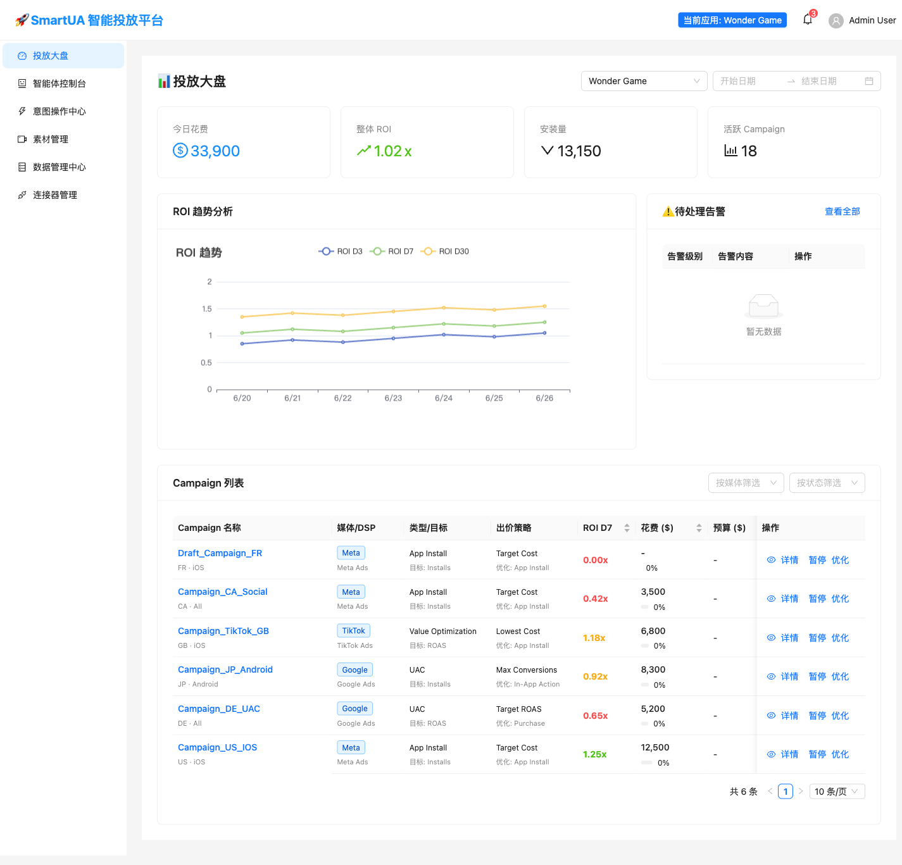
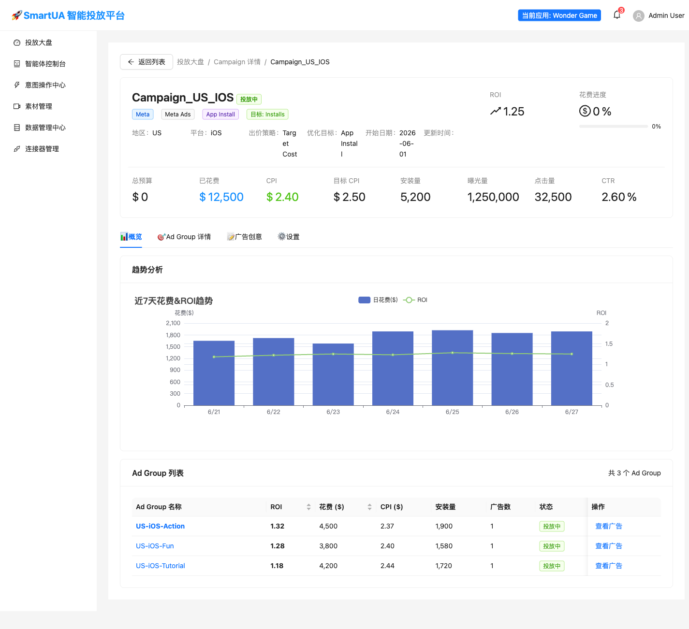
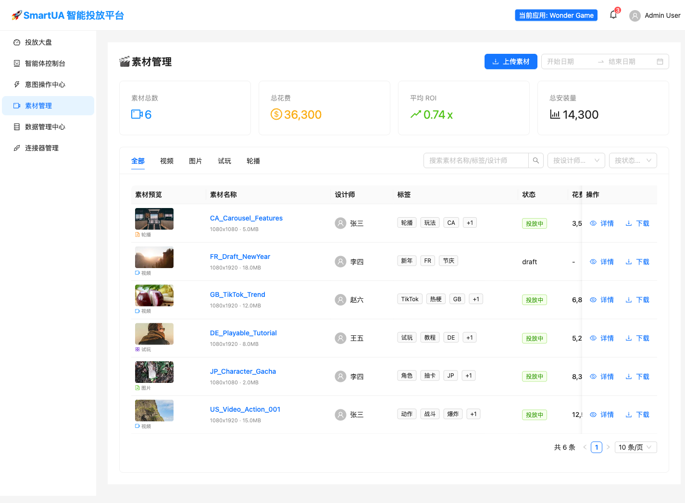
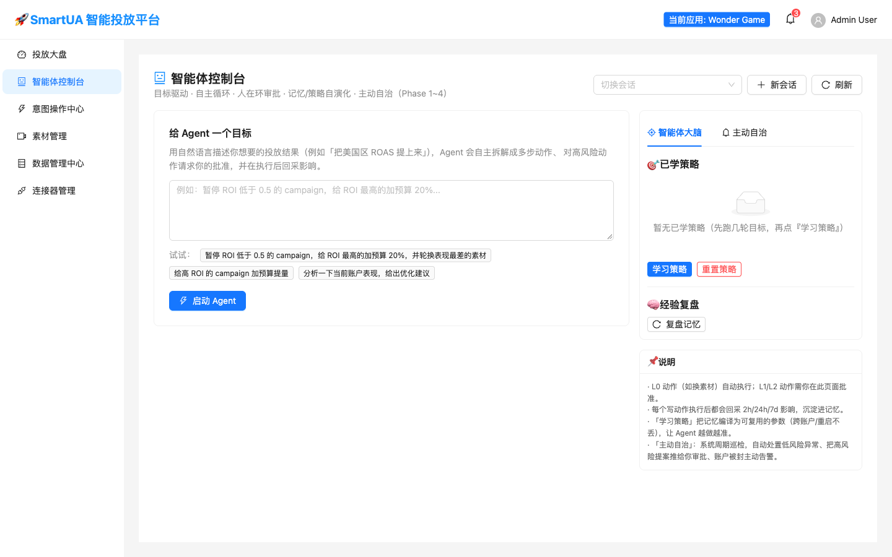

# SmartUA 三屏：解决 UA 看数、执行和策略

> 大盘解决看数，计划详情解决执行，素材库解决策略与供给；放量要走审批。

*本文为独立观察，场景偏出海发行 / 应用（含休闲游戏），不代表任何雇主或客户观点。文中产品截图与数字均来自 abtest.chat/ua 公开演示页（脱敏应用 Wonder Game），统一标注「演示数据」，不是任何真实账户。*

## 一、周会又开成了后台切换大赛

周一上午十点的发行周会。投影上一边是媒体后台，一边是 MMP，本地表格里还摊着自有回收。老板问上周大盘 ROI 到底多少，你在三个窗口之间切了两轮，报出三个数；再问那条跑量计划该不该加预算，没人接话——会议时间全花在找数上，决策留到散会后的聊天记录里。

这种会我旁观过不少次。团队的屏一块不比别人少，缺的是分工：哪块屏回答哪个问题、什么动作只准在哪块屏上做。Funnel 2026-10 报告（Playing defense，233 名 in-house 营销人）里，只有 9% 做到归因 + 增量测试 + MMM 三角测量，大多数团队的周会就是在几套口径之间来回横跳。

我的判断是：**缺的不是又一张表，是同一口径下的屏分工。** 我给这套分工起了个名字，叫「三屏」。

| 屏 | 周会上只回答一个问题 | 允许发生的动作 |
| --- | --- | --- |
| 第一屏 · 通用 ROI 报表（投放大盘） | 大盘正不正常、哪条计划该干预 | 只标记异常，不动任何设置 |
| 第二屏 · 计划详情 | 这条计划该搭、该调，还是该换素材 | 调预算、动 Ad Group、换创意 |
| 第三屏 · 素材库 | 创意供给接不接得住消耗 | 找新创意、复盘素材结构 |

三屏必须跑在同一套口径上：时区、币种、归因窗口、ROI 的 D3 / D7 / D30 定义一致。口径不一致，三屏就是「三个后台三套数」的翻版，只是换了个地方对不上。

## 二、大盘盯异常，详情盯执行，素材库盯供给

**第一屏是用来盯异常的，不是用来逐行念的。** 大盘会只回答两件事：整体回收在不在轨道上，哪几条计划偏离到需要人干预。abtest.chat/ua 的公开演示页里（演示数据），投放大盘把 Meta、TikTok、Google 的 campaign 放进同一张列表：今日花费 $33,900、整体 ROI 1.02x、18 条活跃 campaign，ROI D3 / D7 / D30 三条趋势线同窗展示，偏离的计划直接在列表里标红——比如 CA_Social 这条的 ROI D7 只有 0.42x。周会在这一屏的正确开法，是把时间花在红行上，而不是把六行数字念一遍。

从红行点进去，才到第二屏。**调预算的动作，只在计划详情页发生。** 演示页里这条 Campaign_US_IOS（Meta，投放中）：ROI 1.25，已花费 $12,500，CPI $2.40、低于目标 CPI $2.50，三个 Ad Group 的 ROI 落在 1.18–1.32 之间。搭结构、调预算、换素材，都对着这一屏的刻度做，而且触发条件要事前写死——ROI 低于多少暂停、连续几天达标才加预算——不是会上看着红绿拍脑袋。边界也摆在这里：单条计划样本小，单日波动不等于信号；新 App、新地区这类稀疏数据要单独标记，别和成熟计划混在一张图里比。

第三屏是素材库，很多团队把它当仓库用，这是浪费。**买量的天花板常常是素材供给，不是出价。** 演示页的素材库里一共 16 条素材、总花费 $36,300，平均 ROI 只有 0.74x——翻译一下：创意池整体在拖大盘的后腿，这时候再加预算，只是让差素材烧得更快。素材库要回答的是：跑得动的素材是什么结构（开头玩法、标签、时长），哪类题材、哪位设计师持续出量，库存还够喂几天。创意驱动买量这句话，落到周会上就是每个会留五分钟给第三屏。

## 三、会上说了放量，会后谁改、改了怎么算

三屏解决「看哪里」，还有个老问题没解决：会上一句「给好计划加 20% 预算、把差素材换掉」，散会后常常停在会议纪要里。谁改、改了哪条、改完效果如何，没人留痕，下周周会重新吵一遍。**没有审批和回采的「放量」，只是会议纪要。**

演示页里的意图中心，接的就是这一段。你用一句自然语言给目标——示例指令是「暂停 ROI 低于 0.5 的 campaign，给 ROI 最高的加预算 20%，并轮换表现最差的素材」——它把目标拆成多步动作：低风险动作（比如换素材）自动执行，高风险的调预算、暂停计划推到人在环审批；每个写动作执行之后，按 2h / 24h / 7d 回采影响，沉淀成下一轮的策略记忆。

说白了，它让「放量」从口头表态变成一个可审批、可追溯的动作。但边界要讲清楚：意图中心不替你定战略，也不替你开账户，它只在三屏口径已经对齐的账户上才有正收益。**口径没对齐之前，自动化只会把错误执行得更快。** 平台账和自有账先对上、测可信再谈放量，顺序不能反——这也是上周双账文的核心判断，链接在文末。想体感一下的，可以先拿公开演示页跑一遍示例指令，见 abtest.chat/ua。

---

## 延伸阅读

- 《平台 ROAS 达标了，为什么我还是不让团队加预算》（[公众号文章-AppLovin生态测可信再放量-20261105.md](公众号文章-AppLovin生态测可信再放量-20261105.md)）：平台账 vs 自己账，先测可信，再放量。
- 公开演示页：[abtest.chat/ua](https://abtest.chat/ua)（脱敏应用 Wonder Game，全部为演示数据）。

如果想顺着这个判断往下看：[专题：发行与周会](/topics/publishing-ops/)。有同类问题，也可以[留一个具体场景](/services/#apply)。
