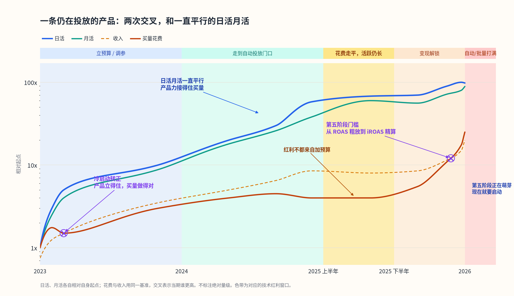

# 还在买量的人，先对上自己卡在第几阶段

> 第五阶段正在萌芽，现在就要启动。

*本文为独立行业观察，基于公开资料整理，不代表任何雇主或客户观点。场景偏 DTC / 应用增长 / 休闲发行，方法通用于买量决策。*

## 一、后台数字不错的时候，最该问自己卡在哪一段

你团队最近的状态，可能是这三种之一。平台后台数字不难看，有人主张再加预算；有人想把自动化选项全部打满；还有人把「上 AIGC」当成下一波必须抢的技术。三种冲动背后是同一个问题：你到底处在买量技术的哪一段。

我的判断先放这儿：**买量技术不是线性升级，而是一串会过期的流量红利窗口。** 从预算门槛、优化师拧参数，到批量、自动化和聚合，再到素材驱动，以及现在的 agent 执行、人做决策，每一跳都在改变流量怎么被分配。窗口开着的时候，先采用的人吃到更便宜的量、更快的学习曲线和更大的放量空间；窗口一关，同样的动作只剩平均成本。所以第一件事不是追新名词，而是对号入座，尽快把这一阶段、以及已经打开的下一阶段的技术用上。

## 二、一条三四年的曲线：两次交叉，和一直平行的日活月活

我对过一条仍在持续投放的出海休闲产品的日活与买量花费全周期。先不谈具体数字，只看曲线怎么走——五个阶段沿这条线排开，真正有说法的，是花费与收入的两次交叉，以及日活和月活始终平行。

*日活、月活各自相对自身起点做成倍数（1x / 10x / 100x）；花费与收入用同一基准，交叉表示当期谁更高。不标注绝对量级。色带是对应的技术红利窗口。前一个交叉是冷启动很快转正；后一个交叉出现在活跃已近 100x、渠道火力全开的时候，这是第五阶段的门槛。最右侧的陡升，是第三阶段（自动/批量）打满，不是第五阶段已经落地。*

先看上面两条线。日活和月活几乎一直平行，说明产品力一直在线，能接住买量——量加进去，活跃结构没有被掀翻。

再看花费和收入的两个交叉。前期花费高于收入，这是冷启动的正常样子；但很快转正，证明产品立得住、买量做得对。此后很长一段时间，收入都走在花费上面。

中间还有一段最该被看见。有一年上半年，该产品的买量花费走平、没有加码，日活和月活却继续涨，月活涨得更多。这不是买量算法突然变便宜，而是产品实验和留存打磨在起作用。**你可以在不加大买量花费的时候继续长日活，红利并不都来自加预算。** 这一段也给后来的增量判断留下对照：不是每一笔花费，都换来同样的增量。

同年下半年，变现能力解锁，同样规模的用户能撑起更多收入，可承受的买量天花板被抬高，弹药变厚。再下一阶段，团队用自动化、批量投放平台把第三阶段加满，花费曲线陡然变陡。就在活跃已经走到近 100 倍、渠道和流量火力全开的时候，花费和收入再次交叉。边界要划清：右侧这条陡升证明的是第三阶段打满，不是第五阶段已经落地；**而这第二次交叉，才是第五阶段的门槛——体量在这里，ROAS 的粗放增长不够用了，必须转到 iROAS（增量 ROAS）和更好的测量。** 自动批量被用满，不等于已经用 increment ROAS 做放量开关，也不等于已经有人审决策的 agentic 流程。

顺手把素材这件事说透。第四阶段是素材驱动，它和第三阶段叠在一起，只作互补，不改主轴。我的看法有点反直觉：**素材战争里的技术部分基本已经结束，AIGC 技术够用了；真正的关键因素是素材创意，AIGC 工具只是杠杆。** 把「上 AIGC 工具」当成下一波要抢的技术红利，是找错了窗口——工具放大的是创意角度的产能，不替你产生角度。

## 三、现在该启动的是第五阶段的萌芽，不是再等一个自动开关

行业窗口已经开到第五阶段的启动和萌芽，不必等「全面 agent 化」。三件能力，现在就要启动。

第一件，agentic 买量：agent 做执行，人掌握点火、放量和停投。盯盘、试计划、搬素材可以交给 agent，无人值守不是目标。公开样本已经是同一套状态机。

Meta 11 月 11 日的工程博客讲 [Intelligent Delivery](https://engineering.fb.com/2026/11/11/ml-applications/intelligent-delivery-serve-better-ads/)：agent 在长上下文里读十年实验日志，自己设计并运行实验，工程师审批后才上线。Meta 自述，2017 年到 2026 上半年的算力调度另外贡献约 10% 排序增量；2026 上半年 agent 贡献约 20% 系统优化；自动化程度最高的机制上，约 80% 的工程 effort 由 agent 完成。这些数字全是 Meta 自述、没有外部审计，我引述，但不替它背书。

同一家公司的官方 Ads MCP（mcp.facebook.com/ads），新建 campaign 默认暂停。至于激活时的确认环节，我只在第三方 [Insightful Pipe 横评](https://insightfulpipe.com/blog/best-mcp-servers-marketing)里看到「AI client 要求确认」的说法，没有独立打开官方文档核对；它能不能等同于服务端硬闸，要存疑——写在提示词里的确认，和服务端真的拦下来，不是一回事。应用层也有同构样本：[AppsFlyer 的 Apple Ads 出价 agent](https://ppc.land/appsflyer-tests-agent-that-changes-apple-ads-bids-once-marketers-approve/) 目前是 closed beta，偏离目标时给建议、营销人批准后才执行；没有公开客户效果数字，这里只谈机制。

第二件，increment ROAS，增量 ROAS，也就是 iROAS。平台后台 ROAS 达标，不等于生意多赚了钱。放量之前，要用 holdout、geo-holdout 或阶段性停投问一句：如果不花这笔钱，收入会少多少？前面那段「花费走平、日活照涨」的曲线，是天然对照；后面那一次花费与收入的交叉，就是这个门槛的位置——从 ROAS 的粗放增长，转到 iROAS 的精细化计算。只看平台账就加预算，吃到的是归因口径，不是增量。这个问题我在[双账文](https://mp.weixin.qq.com/s/BYZsr6xQTo8GPnIsf_JblA)里展开过，这里不重写。

第三件，测量和归因。计划、素材、效果如果由同一个平台生成并判定，广告主手里就没有反驳的证据。要先有的是自有收入账、MMP、平台三本账对齐，归因窗口、时区、币种和切换日期都留底。Google 这周上线的 [Invalid Traffic Overview Card](https://www.adexchanger.com/platforms/google-will-now-tell-you-exactly-how-much-its-crediting-you-for-invalid-traffic/) 是个进展：把拦截前节省（pre-block savings）和账后 credit（post-invoice credit）拆成两个金额，还明确把 agentic activity 纳入无效流量判定；Google 自述，2023 到 2024 年投到无效流量的广告下降了 40%。边界也要看清：判定规则和定义仍在 Google 手里，这还是单边账本，披露变透明不等于能独立复算，独立对账的价值反而上升。

辅证一条。Meta 10 月 28 日的 [Andromeda 工程博客](https://engineering.fb.com/2026/10/28/ml-applications/meta-andromeda-next-gen-ads-retrieval-gpu-co-design/)称，新一代检索自 2025 年起带来 Facebook 转化 +2.4%——Meta 自述、内部口径，广告主拿自己的 holdout 验证过才算数。二手转述里那些全球全量节奏、转化影响幅度的说法，我没核到一手出处，不写成事实。

**没有可审计的测量和增量判定，agent 只会更快地放大一本你核验不了的账。**

## 四、对上号之后，动作就两个字：快装

预算没有消失。没有钱，就进不了模型愿意认真学的量级。**资本决定你能不能上场；技术理解和应用，决定你能不能拿到这一波超额量。** 同样拿着预算的团队，差距会越来越取决于谁先看懂 agent 的执行边界，谁先用 increment ROAS 而不是平台 ROAS 做放量开关，谁先握住自有测量。

多数团队的能力还停在第二、第三阶段，窗口已经开到第五阶段的启动和萌芽。正确姿势是把当前阶段的技术用满，同时提前启动这三件能力，而不是跳过测量去「上一个 agent」。

这三件是互相咬合的：agent 提高试错通量，increment ROAS 决定钱该加在哪、停在哪，自有测量保证你不被平台口径带着走。缺任何一件，另外两件都会打折。

我把五阶段对号表、第五阶段启动项勾选和会前 Yes/No 诊断题，整理成了《买量技术阶段对照》一页纸，诊断题就印在纸里。公众号回复「**阶段对照**」领取，先对号，再看差在哪。

SmartUA可信买量：从通用ROI报表和素材洞察的可信放量，到计划搭建和巡检的提效，最后通过Agent完成策略的沉淀—— SmartUA 的落地路径。想对照自己现在卡在第几阶段，可交换自检或沟通诊断。

广告时间：

- 产品增长咨询：[《PMF到ColdStart ScaleUp如何做可信增长咨询》](https://mp.weixin.qq.com/s/FLDItpwyKsV9pKwl8MQifw)
- 智能投放：[《SmartUA：PMF-ColdStart-Scale的可信信号》](https://mp.weixin.qq.com/s/rWzN614CajV8t_1voOqoGA)

---

## 延伸阅读

- [《平台 ROAS 达标了，为什么我还是不让团队加预算》](https://mp.weixin.qq.com/s/BYZsr6xQTo8GPnIsf_JblA)：平台 ROAS 不等于生意增量，两本账与 holdout 怎么做，这篇讲透了。
- [《发行周会看这三屏就够了》](https://mp.weixin.qq.com/s/9Gn7QLQW3EG9ITJ80aqjfw)：周会三屏各盯什么，agent 放量为什么要走审批。
- Meta Engineering：[Intelligent Delivery: Making Every Unit of Compute Serve Better Ads](https://engineering.fb.com/2026/11/11/ml-applications/intelligent-delivery-serve-better-ads/)（2026-11-11；文中 10% / 20% / 80% 均为 Meta 自述）
- AdExchanger：[Google Will Now Tell You Exactly How Much It's Crediting You For Invalid Traffic](https://www.adexchanger.com/platforms/google-will-now-tell-you-exactly-how-much-its-crediting-you-for-invalid-traffic/)（IVT 双口径首次拆开展示，agentic activity 纳入判定）

---

---

**想对照自己的实验 / 买量决策卡在哪一层？** 可先做 [实验能力自检](/tools/experiment-checkup/)，或从 [服务与预约](/services/#apply) 留下场景。公众号回复文中关键词，也可领取对应一页纸清单。
