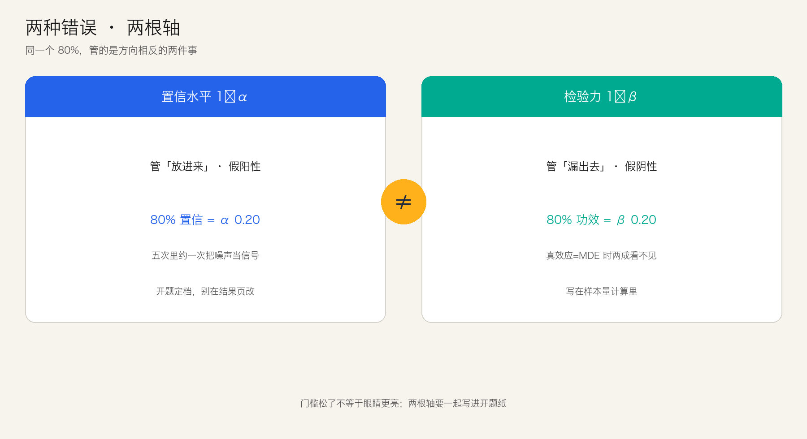

# Google 说 80% 就够，但那个 80% 不是你以为的 80%

> 同一个数字，站在两根不同的轴上。

声明：本文为独立行业观察与方法论整理，基于公开资料，不代表任何雇主或客户观点；本工作室不承接游戏（含手游 / 休闲 / 中重度）行业相关咨询。

今天早上，群里有人贴了条链接，标题大意是「Google 说 80% 置信度就够做方向性测试」。十分钟后会议有了结论：测试周期从四周压到两周，置信档从 95 调到 80。理由是平台自己说的。

我没拦住。因为那条链接没写错，会议也没读错字面意思——错的是同一个「80%」在一句话里出现了两次，指的是两件完全不同的事。

更尴尬的是，我整理这条新闻时，笔记里也顺手写了一句「80% 意味着五次里有一次漏掉真实效果」。写的时候没觉得不对。这就是这个词的传染力：它连写过几十篇实验文章的人都能带偏。

先把结论放这儿：**80% 置信和 80% 检验力，数字一样，管的是两种方向相反的错误。**

## 一、一个管放进来，一个管漏出去

经典假设检验里只有两种错误。改动其实没用，你说有用——假阳性，一类错误，概率记作 α。改动真有用，你说没用——假阴性，二类错误，概率记作 β。

置信水平是 1−α。95% 置信就是 α=0.05，80% 置信就是 α=0.20。它管的是「放进来」：如果这个改动其实没用，你还有 20% 的机会判它显著。所以 80% 对应的风险是「五次里有一次把噪声当信号」，是假阳性。95% 对应二十分之一。

检验力是 1−β。算样本量时习惯设 80%，意思是：如果真实效应刚好等于你预设的最小可检测效应（MDE），你有 80% 的机会把它测出来。它管的是「漏出去」——两成的机会，真有东西你没看见。

*同一份数据，四格里只有两格是「判对了」。α 是你设在门口的门槛，β 是你的眼睛够不够亮。*

| 你看到的说法 | 管哪种错误 | 常见档位 | 什么时候定 | 调高它意味着 |
|---|---|---|---|---|
| 置信水平 1−α | 假阳性（放进来） | 95%；Google 新增 80% / 85% | 读区间时看，但应该开题就定 | 门槛更严，更难通过 |
| 检验力 1−β | 假阴性（漏出去） | 80%，写在样本量计算里 | 开题算样本时 | 更容易看见真效应，但要更多样本 |

一句话：**置信水平是你设在门口的门槛，检验力是你的眼睛能看多远。** 前者印在结果页上，后者从来不出现在结果页上——这就是混淆的物理原因，不是谁数学不好。

## 二、Google 那句话，是一次明码标价的兑换

把 α 从 0.05 放到 0.20，判定线从 1.96 个标准误挪到 1.28 个。同一份数据，门槛往里收了一大截。

这件事有个很少被提到的副作用：功效会跟着涨。因为功效本来就依赖 α，门槛松了，同一个真效应更容易过线。所以「降到 80%」不是单向降级。它同时买到了三样东西：更容易看见真的改进、更少的样本、更短的周期。官方文档里，monitoring 页写 80% 默认、2–3 周，methodology 页写 95% 和每臂 20 个 bucket，播客里又说 4–6 周，Google 的人自己承认这只是 heuristic。三处口径不一致，我不替它圆。

所以更准确的说法不是「Google 降低了实验标准」，而是：**它把假阳性的价格标出来了，让你自己选买多少。** 方向性微调错了，代价可控，两成的假阳性可以接受。换一套出价策略、重构账户这类改动，错了要几个月才爬得出来，那就该用 95%，把结论往没参试的 campaign 外推时更该用 95%——这也是官方文档自己写的。

这套逻辑站得住。真正的问题在落地，有三处。

**第一处，阈值可以在报告页随时改。** 先看 95% 不显著，切到 80% 显著，然后推全。同一份数据，试到通过为止。官方没说这是推荐用法，但开关就在结果页上。

**第二处，部分实验类型默认自动应用。**按 PPC Land 对官方文档的核读，有些实验连「开启」都不用点。门槛降了，签字的人还不在场。

**第三处，结果不能自己复算。**你拿到的是一个绿灯，不是样本量、转化数和方差。想知道这个绿灯是怎么亮的，只能信它。

三条放在一起，降的就不是统计标准，是决策的可审计性。上周写 Meta 那套四道闸门时我记过一句：agent 接走六成活，最后一道人工终审一道没少。这边的对比有点刺眼——那边是活越多、签字越重；这边是门槛松了、还自动应用。

## 三、80% 该不该用：先看你手里的想法值多少

统计门槛不是真理标准，它是成本函数。同样一个 80%，放在「十个想法九个错」的团队里，和放在「有强先验、只验证一个明确假设」的人手里，后果完全不同。

粗算一下。假设你测 10 个想法，只有 1 个是真的，真效应刚好等于 MDE，双侧检验：

- 80% 门槛：真的那个约 94% 过线（同一套样本，α 放宽后功效跟着涨），9 个假的各 20% 过线。期望 2.7 个过线，其中 1.8 个是假的，占三分之二。
- 95% 门槛：真的那个 80% 过线，9 个假的各 5%。1.25 个过线，假货占三成多。

不是「80% 一定错」，是**你的胜利清单会变脏**。跑得越多、想法越水，脏得越快。更麻烦的是，脏的方式很隐蔽：每一个过线的结论单看都合规，合起来看才知道有三分之二是噪声。

所以定档位的时候，问三个问题，比问「这个改动大不大」靠谱：

1. 这个改动错了，多久能发现、多贵能改回来？
2. 动手之前，你对它有效这件事有多大把握？
3. 结论要不要外推到没参试的人群、季节、预算规模？

前两个决定你能不能吃 80%。第三个基本决定了你不能——外推那一格，官方也只给 95%。

## 四、把一次实验的决策写成一张纸

我见过的翻车，大多不是算错，是没写下来。写下来的东西才有资格被复核。

五件事，开题前写完，一页纸够：

1. 这次要做的决策是什么，错了赔多少。不是「测一下素材」，是「涨不涨价」「加不加这一档预算」。
2. MDE 定在业务上值得做的最小效应。不是「看能测出啥」，是「小于这个数我就不动」。
3. α 和 power 一起算样本。只报一个的都是耍流氓：α 决定放进来多少，power 决定看得见多远。
4. 预注册：指标、α、MDE、停时规则、外推范围。尤其是 α——写完就别在结果页改。
5. 存原始数。样本量、转化数、方差。能自己复算的结论，才敢拿去签字。

最后一句判断：**实验做到最后，拼的不是统计软件，是这套结论敢不敢签字。** 平台可以给你一个绿灯，给不了你的签字。

## 互动

这篇的起点是一个真实的误会，所以也想听听你那边的：你们团队的实验，置信档是开题定的，还是看结果的时候顺手选的？

回复「两根轴」，我发你一份《实验决策一页纸》：α/β 对照表、四格错误图、五问决策卡，背面是「口径—预注册—复算—闸门」四段的检查项，附 5 道自测题。

实验这条线，我交付的从来不是一套平台，是四件事：口径能对齐、假设能预注册、结论能复算、发布有人签字。哪一段断了，一页纸背面就能看出来。

广告时间：

- 产品增长咨询：[《PMF到ColdStart ScaleUp如何做可信增长咨询》](https://mp.weixin.qq.com/s/FLDItpwyKsV9pKwl8MQifw)
- 智能投放：[《SmartUA：PMF-ColdStart-Scale的可信信号》](https://mp.weixin.qq.com/s/rWzN614CajV8t_1voOqoGA)

---

## 延伸阅读

- [《1,100 人测出的 18.8 个百分点，为什么能下结论？》](/posts/2026-11-18-experiment-cost-sample-size/)：那篇算的是样本和 MDE，这篇补它缺的另一半——α 和 β 各自管什么。
- 《Meta 让 agent 接走 60% 的实验迁移，四道闸门一道没少》（站内待收录）：门槛可以调，最后那道人工终审不能省。
- [Google 80% confidence 原文报道（PPC Land，2026-11-19）](https://ppc.land/google-says-80-confidence-is-good-enough-for-directional-ad-tests/)：三档置信度与预算测试拆分的原始出处，转述与官方文档口径差异一并记录在案。

---

---

**想对照自己的实验 / 买量决策卡在哪一层？** 可先做 [实验能力自检](/tools/experiment-checkup/)，或从 [服务与预约](/services/#apply) 留下场景。公众号回复文中关键词，也可领取对应一页纸清单。
